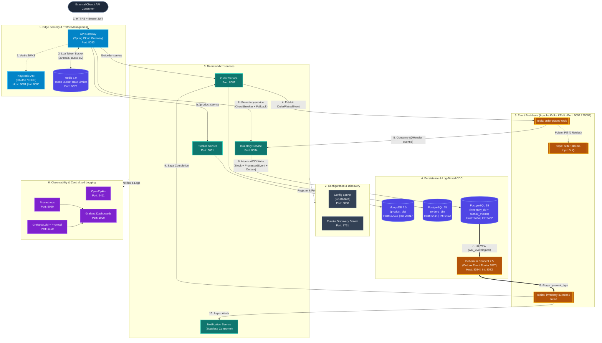

# ClickArt: Production-Grade Distributed E-Commerce Architecture

## Executive Summary
ClickArt is an event-driven, fault-tolerant backend system built on **Spring Boot 3** designed to handle high-throughput, asynchronous business workflows. It eliminates single points of failure, data loss during partial outages, and distributed transaction inconsistencies through the **Choreography-Based Saga Pattern**, **Transactional Outbox with Log-Based CDC (Debezium)**, **Idempotent Consumers**, **Circuit Breakers**, and **Distributed Token Bucket Rate Limiting**.

---

## 1. System Architecture & Event Flow



---

## 2. Infrastructure, Network Topology & Port Matrix

| Component / Service | Technology & Version | Protocol | Host Port | Container Port | Persistence / Architectural Role |
| :--- | :--- | :--- | :--- | :--- | :--- |
| **API Gateway** | Spring Cloud Gateway `4.x` (WebFlux) | HTTP | `8083` | `8083` | Edge security, JWT validation, Redis rate limiting, circuit breaking |
| **Keycloak IAM** | Keycloak `23.0` | HTTP | `8081` | `8080` | OAuth2 / OIDC Identity Provider, JWKS cryptographic token verification |
| **Config Server** | Spring Cloud Config `4.x` | HTTP | `8888` | `8888` | Centralized Git-backed configuration management (`JCE` encrypted) |
| **Discovery Server** | Netflix Eureka `4.x` | HTTP | `8761` | `8761` | Dynamic service registry and client-side load balancing (`lb://`) |
| **Product Service** | Spring Boot `3.2.x` (Java `17`) | HTTP | `8081` *(Local)* | `8080` | Product catalog domain CRUD and query operations |
| **Order Service** | Spring Boot `3.2.x` (Java `17`) | HTTP | `8082` *(Local)* | `8080` | Order lifecycle orchestration and Saga initiator |
| **Inventory Service** | Spring Boot `3.2.x` (Java `17`) | HTTP | `8084` *(Local)* | `8080` | Stock mutation, SQL idempotency (`ProcessedEvent`), Transactional Outbox |
| **Notification Service**| Spring Boot `3.2.x` (Java `17`) | HTTP | *Internal* | `8080` | Stateless Kafka event consumer for customer notifications |
| **Apache Kafka** | Apache Kafka `3.7.0` (KRaft) | TCP | `9092` | `29092` | Distributed event bus (Zookeeper-less KRaft consensus, `9093` controller) |
| **Debezium Connect** | Debezium `2.5` | HTTP | `8084` *(Docker)*| `8083` | Log-based CDC engine streaming Postgres WAL logs via Outbox SMT |
| **PostgreSQL** | PostgreSQL `15-alpine` | TCP | `5434` | `5432` | Relational ACID storage (`orders_db`, `inventory_db`, `wal_level=logical`) |
| **MongoDB** | MongoDB `7.0` | TCP | `27018` | `27017` | Document store (`product_db`) for catalog attributes |
| **Redis** | Redis `7.0-alpine` | TCP | `6379` | `6379` | Distributed in-memory state store for Token Bucket rate limiting |
| **Prometheus** | Prometheus `v2.45.0` | HTTP | `9090` | `9090` | Time-series metrics scraping via `/actuator/prometheus` |
| **Grafana** | Grafana `10.0.3` | HTTP | `3000` | `3000` | Operational observability dashboards (Metrics + Logs) |
| **OpenZipkin** | OpenZipkin `latest` | HTTP | `9411` | `9411` | Distributed request trace & span correlation across HTTP and Kafka |
| **Grafana Loki** | Loki `2.9.0` & Promtail `2.9.0` | HTTP | `3100` | `3100` | Centralized container log aggregation |

---

## 3. Architectural Patterns & Problem Resolution

### 1. Perimeter Security & Edge Routing
* **Pattern:** API Gateway Pattern (`Spring Cloud Gateway` Reactive WebFlux)
* **Problem Solved:** Direct client-to-service communication exposes internal network topologies, complicates CORS policies, and causes thread starvation under unauthenticated traffic spikes.
* **Implementation:** Acts as a non-blocking reverse proxy on port `8083`, terminating external HTTP requests, validating JWTs via Keycloak at the perimeter, and dynamically routing traffic to internal microservice instances via Eureka (`lb://`).

### 2. Edge Identity & Access Management (IAM)
* **Pattern:** Centralized OAuth2/OIDC Resource Server (`Keycloak 23.0`)
* **Problem Solved:** Redundant, inconsistent authentication logic scattered across discrete domain microservices.
* **Implementation:** The Gateway cryptographically validates JWT access tokens statelessly against Keycloak’s JWKS endpoint (`/protocol/openid-connect/certs`), extracting the principal subject (`sub` claim) for downstream auditing and rate limiting.

### 3. Edge Rate Limiting & Denial-of-Service Protection
* **Pattern:** Distributed Token Bucket Algorithm (`Redis 7.0`)
* **Problem Solved:** Volumetric API abuse or rogue clients exhausting downstream database connection pools and causing JVM Out-Of-Memory (OOM) crashes.
* **Implementation:** Reactive Redis executes atomic Lua scripts tracking request quotas per authenticated user ID (`sub` claim, falling back to `"anonymous"`). Enforces `replenishRate: 20` req/s and `burstCapacity: 50`, immediately rejecting excess traffic with `HTTP 429 Too Many Requests`.

### 4. Cascading Failure Prevention
* **Pattern:** Circuit Breaker & Fallback (`Resilience4j 2.2.0`)
* **Problem Solved:** Synchronous network latency or downstream outages causing thread pool exhaustion across upstream callers.
* **Implementation:** Wraps network boundaries with count-based sliding windows (`slidingWindowSize: 20`, `failureRateThreshold: 50%`, `waitDurationInOpenState: 10s`). Trips open on downstream degradation and forwards requests to local fallback handlers (`/fallback/inventory` returning `HTTP 503`).

### 5. Distributed Transaction Management
* **Pattern:** Choreography-Based Saga (`Apache Kafka 3.7.0`)
* **Problem Solved:** Distributed ACID transactions and Two-Phase Commit (2PC) introduce severe lock contention, high latency, and single points of coordination failure across heterogeneous databases.
* **Implementation:** Decentralized, event-driven state transitions across `order-placed-topic`, `inventory-success-topic`, and `inventory-failed-topic`. Services execute local ACID transactions and emit domain events to trigger compensating rollbacks upon business rule violations (e.g., insufficient stock).

### 6. Dual-Write Consistency Guarantee (Log-Based CDC)
* **Pattern:** Transactional Outbox Pattern with Log-Based Change Data Capture (`PostgreSQL 15 WAL` + `Debezium 2.5`)
* **Problem Solved:** Non-atomic dual writes (committing to PostgreSQL and publishing to Kafka inside the same method) risk permanent data inconsistency if the process crashes or the broker disconnects mid-execution. Furthermore, application-side `@Scheduled` SQL polling introduces database query overhead and multi-instance lock contention.
* **Implementation:** `InventoryService` persists inventory mutations and inserts an `OutboxEvent` record into `outbox_events` within a single local ACID transaction. Debezium tails PostgreSQL's binary Write-Ahead Log (`wal_level=logical`) using the `pgoutput` plugin and applies the **Outbox Event Router Single Message Transform (SMT)** to stream events directly to Kafka with sub-millisecond latency and zero polling load.

### 7. Consumer Deduplication
* **Pattern:** Idempotent Consumer (`SQL-Level Deduplication`)
* **Problem Solved:** Kafka’s *at-least-once* delivery semantics cause duplicate message delivery during network retries or consumer group rebalances, risking double-deduction of inventory.
* **Implementation:** Extracts the unique `eventId` header from incoming Kafka records and checks `processed_events` (`existsById(eventId)`). Stock mutation, outbox persistence, and `ProcessedEvent` insertion commit atomically within the same `@Transactional` boundary.

### 8. Poison Pill Isolation
* **Pattern:** Dead-Letter Queue (DLQ) & Non-Retryable Exception Isolation (`Spring Kafka`)
* **Problem Solved:** Unhandled serialization errors or corrupted JSON payloads cause consumers to crash in an infinite retry loop, resulting in Head-of-Line (HoL) blocking across the entire Kafka partition.
* **Implementation:** Configured `DefaultErrorHandler` with `DeadLetterPublishingRecoverer` and a `FixedBackOff(1000L, 3)` for transient errors. Registered `SerializationException`, `MessageConversionException`, and `JsonProcessingException` as non-retryable exceptions, routing malformed poison pills immediately to `order-placed-topic.DLQ` with zero retries.

### 9. Distributed Tracing & Observability
* **Pattern:** Distributed Context Propagation (`Micrometer Tracing` + `OpenZipkin` + `Prometheus` + `Loki`)
* **Problem Solved:** Inability to correlate asynchronous requests, diagnose latency bottlenecks, or trace failures across HTTP and Kafka boundaries.
* **Implementation:** Propagates `traceId` and `spanId` headers across Gateway routes and Kafka producers/consumers into Zipkin (`9411`), scrapes JVM/application metrics via Prometheus (`9090`), and aggregates container logs via Promtail & Loki (`3100`) into Grafana (`3000`).

---

## 4. API Documentation & Swagger (OpenAPI 3.0)

Each domain microservice exposes interactive OpenAPI 3.0 specifications accessible directly or routed through the API Gateway:

| Service | Gateway Routed OpenAPI Spec | Local Swagger UI | Core Endpoints |
| :--- | :--- | :--- | :--- |
| **API Gateway** | `http://localhost:8083/v3/api-docs` | `http://localhost:8083/swagger-ui.html` | Edge proxy & rate-limited ingress |
| **Product Service** | `http://localhost:8083/product-service/v3/api-docs` | `http://localhost:8081/swagger-ui.html` | `POST /api/product`, `GET /api/product` |
| **Order Service** | `http://localhost:8083/order-service/v3/api-docs` | `http://localhost:8082/swagger-ui.html` | `POST /api/order`, `GET /api/order/{id}` |
| **Inventory Service** | `http://localhost:8083/inventory-service/v3/api-docs` | `http://localhost:8084/swagger-ui.html` | `GET /api/inventory`, `PUT /api/inventory` |

---

## 5. Implementation Status & Project Roadmap

### Completed Milestones
- [x] **Perimeter Security & Gateway Routing:** Spring Cloud Gateway with Keycloak OAuth2/OIDC JWT validation and OpenAPI path rewrites.
- [x] **Distributed Rate Limiting:** Redis Token Bucket filter (`replenishRate: 20`, `burstCapacity: 50`) keyed by JWT principal.
- [x] **Fault Isolation & Fallbacks:** Resilience4j Circuit Breakers and TimeLimiters configured on Gateway and inter-service calls.
- [x] **Choreographed Saga & Idempotent Consumer:** Event-driven stock deduction backed by SQL-level `ProcessedEvent` deduplication.
- [x] **Poison Pill DLQ Isolation:** `DefaultErrorHandler` and `DeadLetterPublishingRecoverer` routing fatal deserialization failures to `.DLQ`.
- [x] **Log-Based CDC Outbox Pipeline:** PostgreSQL logical decoding (`wal_level=logical`) integrated with Debezium Kafka Connect Outbox SMT.
- [x] **Real-Infrastructure Integration Testing:** Automated **Testcontainers** suite (`PostgreSQLContainer` & `KafkaContainer`) with `Awaitility` verifying idempotency and DLQ routing (`InventoryIdempotencyIntegrationTest`, `InventoryDlqIntegrationTest`).
- [x] **Observability Stack:** Dockerized Prometheus, Grafana, OpenZipkin, Loki, and Promtail pipeline.

### Pending Roadmap
- [ ] **Multi-Stage Containerization:** Author production-hardened, multi-stage `Dockerfile` builds using Eclipse Temurin 17 JRE and non-root execution users.
- [ ] **Kubernetes Orchestration (`k8s/`):** Declarative manifests (`Deployments`, `StatefulSets`, `Services`, `ConfigMaps`, `Secrets`) with Actuator-backed `livenessProbe` and `readinessProbe` configurations.
- [ ] **CI/CD Automation (GitHub Actions):** Automated build pipeline executing Testcontainers verification and pushing versioned Docker images.
- [ ] **Zero-Trust Service Mesh (mTLS):** Mutual TLS encryption for internal east-west microservice traffic.

---

## 6. Local Execution & Verification Guide

### 1. Boot the Full Infrastructure & Application Stack
```bash
docker compose up -d
```

### 2. Register the Debezium Outbox Connector
Once `clickart-debezium` is healthy on port `8084`, register the PostgreSQL WAL Outbox connector:
```bash
curl -i -X POST -H "Accept:application/json" -H "Content-Type:application/json" \
  http://localhost:8084/connectors/ \
  -d '{
    "name": "inventory-outbox-connector",
    "config": {
      "connector.class": "io.debezium.connector.postgresql.PostgresConnector",
      "tasks.max": "1",
      "plugin.name": "pgoutput",
      "database.hostname": "clickart-postgres-1",
      "database.port": "5432",
      "database.user": "test",
      "database.password": "test",
      "database.dbname": "inventory_db",
      "topic.prefix": "clickart_inventory",
      "table.include.list": "public.outbox_events",
      "tombstones.on.delete": "false",
      "transforms": "outbox",
      "transforms.outbox.type": "io.debezium.transforms.outbox.EventRouter",
      "transforms.outbox.route.by.field": "event_type",
      "transforms.outbox.route.topic.replacement": "${routedByValue}",
      "transforms.outbox.table.field.event.id": "id",
      "transforms.outbox.table.field.event.key": "aggregate_id",
      "transforms.outbox.table.field.event.payload": "payload"
    }
  }'
```

### 3. Verify Connector Health
```bash
curl -s http://localhost:8084/connectors/inventory-outbox-connector/status | jq .
```

### 4. Execute Testcontainers Integration Suite
```bash
cd inventory-service
mvn clean test
```